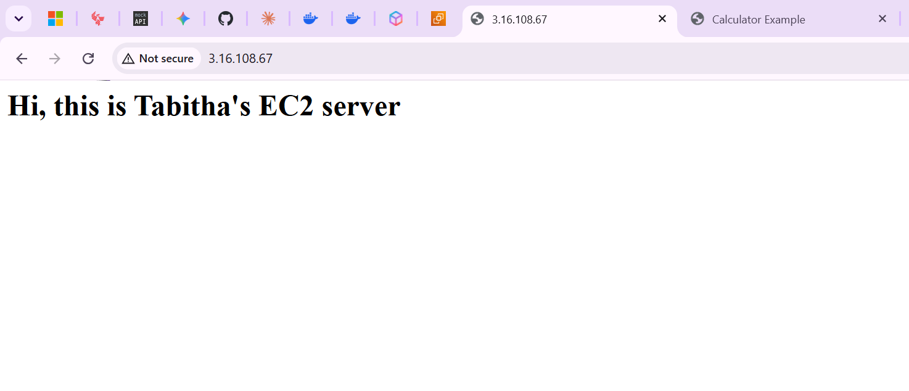

# Module 10 Exercise 3 - AWS EC2

I made my own Ubuntu server on AWS using the free tier.

## WHAT I PICKED
- Name: tabitha-web-server
- OS: Ubuntu (free tier eligible)
- Instance type: t3.micro (free tier eligible)
- Region: US East (Ohio)
- Key pair: tabitha-key (.pem). I kept it on my computer, NOT in this repo.
- Network: SSH from My IP, HTTP and HTTPS from anywhere

## STARTUP SCRIPT
The script in the slides only works on Amazon Linux 2, so I used a short Ubuntu one instead. It's in `user-data.sh`. It installs apache2 and makes a simple page.

## IT WORKS
I went to http://3.16.108.67 and saw my page.

Notes Ref: Module 10 Part 2 slides
