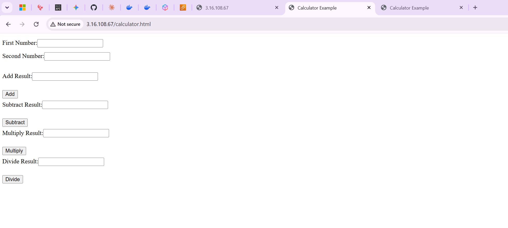

# Module 10 Exercise 4 - Docker image on EC2

I put my calculator Docker image (the one GitHub Actions pushes in Exercise 2) on my EC2 server from Exercise 3.

## COMMANDS I RAN
Log in from Git Bash with my key:
```
ssh -i tabitha-key.pem ubuntu@3.16.108.67
```

Install and start Docker:
```
sudo apt update
sudo apt install -y docker.io
docker --version
sudo systemctl start docker.service
sudo systemctl status docker
```

Run my app:
```
sudo docker pull tabithacodes/calculator
sudo systemctl stop apache2
sudo docker run -d -p 80:3000 tabithacodes/calculator
sudo docker ps
```

## WHAT'S DIFFERENT FROM THE SLIDES
My server is Ubuntu, not Amazon Linux, so:
- user is `ubuntu` not `ec2-user`
- the package is `docker.io` not `docker`
- I stopped `apache2` not `httpd`
- `80:3000` because my app runs on 3000, not 8080

## IT WORKS
http://3.16.108.67/calculator.html



Docker Hub: https://hub.docker.com/repository/docker/tabithacodes/calculator/general

Notes Ref: Module 10 Part 2 slides
