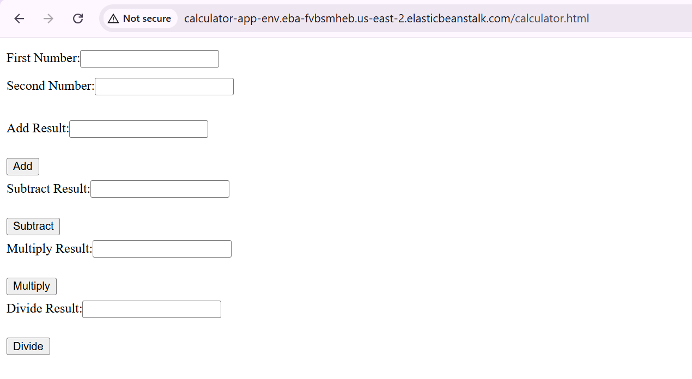

# Module 10 Exercise 5 - AWS Elastic Beanstalk

I hosted my calculator app on Elastic Beanstalk. The slides said to use a standalone repo, so the code is in its own repo here:
https://github.com/tabitha-codes/Module10Lab05

I had to put it in its own repo because Elastic Beanstalk needs package.json at the top. In this repo it's 4 folders down.

## WHAT I DID
1. Made an IAM role called `aws-elasticbeanstalk-service-role` with the 5 Beanstalk policies from the slides
2. Made a Beanstalk app called `calculator-app`
   - Node.js, sample application to start
   - Single instance (free tier)
   - Health reporting Basic, managed updates off
   - Environment property PORT = 8080 (my index.js uses process.env.PORT)
3. Made a CodePipeline called `calculator-pipeline`
   - Source: GitHub, Module10Lab05, main branch
   - Deploy: Elastic Beanstalk, calculator-app
4. Now when I push to Module10Lab05 it deploys on its own

## WHAT WENT WRONG
The first deploy failed with:
`role does not have elasticbeanstalk:CreateApplicationVersion`

The pipeline's role didn't have permission to use Beanstalk. I fixed it by going to IAM and adding the
`AdministratorAccess-AWSElasticBeanstalk` policy to `AWSCodePipelineServiceRole-us-east-2-calculator-pipeline`.
Then I clicked Release change and it went green.

## IT WORKS
http://calculator-app-env.eba-fvbsmheb.us-east-2.elasticbeanstalk.com/calculator.html

Notes Ref: Module 10 Part 2 slides
